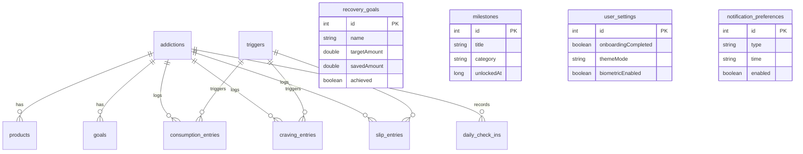

# Tide 🌊

> **Understand the pattern. Change the tide.**
> 
> A calm, privacy-first, addiction-agnostic habit tracking and behavioral recovery companion for Android.

[](https://developer.android.com)
[](https://kotlinlang.org)
[-4285F4?logo=jetpackcompose&logoColor=white)](https://developer.android.com/jetpack/compose)
[](https://developer.android.com/training/data-storage/room)
[-black)](https://developer.android.com/about/versions/15)
[-black)](https://developer.android.com)
[](https://github.com/vinaynalavade/Tide/releases/tag/v1.0.0-build1)
[](LICENSE)

---

## Table of Contents

- [Overview](#overview)
- [Core Philosophy](#core-philosophy)
- [Key Features](#key-features)
  - [1. Addiction-Agnostic Tracking](#1-addiction-agnostic-tracking)
  - [2. Goal-Adaptive Architecture](#2-goal-adaptive-architecture)
  - [3. Signature Craving Mode & Tidal Breathing](#3-signature-craving-mode--tidal-breathing)
  - [4. Mathematical Precision & Historical Price Immutability](#4-mathematical-precision--historical-price-immutability)
  - [5. Smart Behavioral Insights & Custom Canvas Charts](#5-smart-behavioral-insights--custom-canvas-charts)
  - [6. History Calendar & Timeline Inspection](#6-history-calendar--timeline-inspection)
  - [7. Financial Recovery Goals & Milestones](#7-financial-recovery-goals--milestones)
  - [8. Privacy, Local-First Architecture & Data Ownership](#8-privacy-local-first-architecture--data-ownership)
- [App Experience & Design Aesthetics](#app-experience--design-aesthetics)
- [Architecture & Tech Stack](#architecture--tech-stack)
  - [System Architecture](#system-architecture)
  - [Data Model & Entities](#data-model--entities)
  - [Technology Stack](#technology-stack)
- [Project Structure](#project-structure)
- [Getting Started](#getting-started)
  - [Prerequisites](#prerequisites)
  - [Building from Source](#building-from-source)
  - [Running Tests & Lint](#running-tests--lint)
- [Release Signing & Production Packaging](#release-signing--production-packaging)
  - [Signing Configuration](#signing-configuration)
  - [Building Signed Release APK & Play Store AAB](#building-signed-release-apk--play-store-aab)
  - [Upload Key Identity](#upload-key-identity)
- [In-App Updates](#in-app-updates)
- [Medical Disclaimer](#medical-disclaimer)
- [Roadmap](#roadmap)
- [Author & Acknowledgments](#author--acknowledgments)

---

## Overview

**Tide** is a native Android application designed to help individuals track, understand, and overcome compulsive habits and addictions. Rather than relying on punitive gamification, guilt mechanics, or rigid smoke-only tracking, Tide treats recovery as an observant, compassionate, and analytical journey.

Whether tracking substance use (smoking, alcohol, vaping, caffeine), digital habits (social media, gaming), or compulsive behaviors (gambling, sugar, compulsive shopping), Tide adapts its language, mathematics, units, and dashboard metrics to match the user's specific context and chosen goal.

Built from the ground up with **modern Android standards**—including Jetpack Compose, Kotlin 2.0 Coroutines and Flow, Room SQLite database, and an edge-to-edge glassmorphic design system—Tide is local-first, zero-telemetry, and fully operational offline.

---

## Core Philosophy

Traditional habit trackers often exacerbate compulsive cycles by weaponizing guilt: broken streaks reset everything to zero, shaming copy implies failure, and rigid structures assume abstinence is the only valid goal.

Tide breaks this pattern through a four-stage psychological feedback loop:

$$\textbf{TRACK} \longrightarrow \textbf{UNDERSTAND} \longrightarrow \textbf{INTERRUPT} \longrightarrow \textbf{IMPROVE}$$

1. **TRACK Without Shame**: Slips and consumption are logged objectively. Slips reset only the current consecutive streak—historical achievements, total clean days, money saved, and lifetime progress remain permanently intact.
2. **UNDERSTAND Through Patterns**: Cravings and usages are logged with emotional moods and environmental triggers, highlighting the underlying causes rather than just surface numbers.
3. **INTERRUPT In The Moment**: When a craving strikes, Tide provides an immediate, calming somatic intervention (the 1-minute Tidal Breathing Wave) to de-escalate physiological urges.
4. **IMPROVE Adaptively**: Progress metrics adapt dynamically depending on whether the user chose to **Quit**, **Reduce**, or simply **Track** their habit.

---

## Key Features

### 1. Addiction-Agnostic Tracking
Tide does not force generic smoking terminology onto diverse habits. Labels, calculation formulas, and dialogs dynamically calibrate to the selected habit:

| Category | Primary Unit | Pricing Basis Example |
|---|---|---|
| **Smoking** | Cigarette | Price per pack (e.g. 10 or 20 cigarettes) |
| **Alcohol** | Drink / Glass / Bottle | Price per bottle or serving |
| **Vaping** | Session / Puff / Pod | Price per pod or bottle |
| **Social Media** | Hours / Minutes | Time-based opportunity cost |
| **Gaming** | Hours / Sessions | Time-based tracking |
| **Gambling** | Session / Direct ₹ Amount | Direct monetary loss tracking |
| **Food / Sugar** | Serving / Piece | Price per item or daily cost |
| **Caffeine** | Cup / Can | Price per beverage |
| **Custom Habit** | User-defined unit | Flexible unit cost & frequency |

### 2. Goal-Adaptive Architecture
The user interface changes fundamentally based on the active goal mode:

- **QUIT**: Displays days since last use, current clean streak, longest streak, avoided consumption units, and lifetime money saved.
- **REDUCE**: Focuses on harm reduction. Displays today's consumption vs. target limit, remaining daily allowance, target-met streak, and percentage reduction against baseline. *Days where consumption remains within the target allowance are celebrated as target successes without misleadingly labeling them "clean days."*
- **TRACK**: Non-judgmental observational logging. Focuses on usage patterns, logging frequency, emotional triggers, and total spending without punitive fail states.

### 3. Signature Craving Mode & Tidal Breathing
When urge intensity spikes, the user can tap the dedicated **"I'm having a craving"** banner to immediately launch **Craving Mode**:
- **4-4-4-2 Box Breathing Wave**: A custom Compose Canvas animation guides the user through **Inhale (4s)**, **Hold (4s)**, **Exhale (4s)**, and **Rest (2s)** cycles.
- **Somatic Wave Visualization**: Multi-layered radial gradients expand and contract smoothly, paired with calming timing indicators.
- **Post-Intervention Check-In**: Evaluates urge progression (*Better*, *Same*, or *Worse*).
- **Harm-Reduction Actions**: Users can trigger an additional minute, contact a trusted helpline, or log the craving directly with intensity (1–10 scale), active trigger, and notes.

### 4. Mathematical Precision & Historical Price Immutability
All financial and quantitative algorithms are handled by a dedicated, pure Kotlin calculation engine ([`TideCalculationEngine`](file:///X:/Tide/app/src/main/java/com/tide/app/core/calculation/TideCalculationEngine.kt)):
- **Historical Price Protection**: Modifying a product's price today never mutates historical cost entries. Every entry locks in its calculated unit cost at the exact epoch timestamp of entry creation.
- **Baseline vs. Actual Savings**: For Reduce mode, savings are calculated as $\text{Baseline Expected Cost} - \text{Actual Cost}$. If baseline is ₹200/day and ₹100 was spent, money saved is correctly evaluated as ₹100.
- **Avoided Consumption**: Calculated accurately across historical days rather than naively multiplying baseline by the current active streak.

### 5. Smart Behavioral Insights & Custom Canvas Charts
- **The Smart Insight Rule**: Prevents premature or misleading behavioral conclusions. Insights enforce a strict $\ge 3$ days of logged data threshold before asserting trends; otherwise displaying: *"Keep logging to discover your patterns."*
- **Custom Glow Trend Charts**: Hardware-accelerated Compose Canvas line chart rendering 7-day and 30-day consumption trends with smooth cubic Bézier curves, filled gradient shadows, and min/max baseline guides.
- **Trigger Distribution**: Categorizes cravings and slips against contextual triggers (e.g., *Stress*, *Social / Friends*, *After Meals*, *Boredom*, *Driving*) with percentage distributions.
- **Craving Resistance Ratio**: Accurately tracks resisted vs. acted cravings and average urge intensity.

### 6. History Calendar & Timeline Inspection
- **Monthly Recovery Calendar**: Displays color-coded semantic dots for every day of the month (*Goal Met*, *Reduced / Within Limit*, *Slip*, or *No Data*).
- **Interactive Day Inspector**: Tapping any calendar day slides up a bottom sheet with a complete chronological breakdown: total consumption, slips, resisted cravings, check-in mood, and individual timestamped notes.

### 7. Financial Recovery Goals & Milestones
- **Savings Allocation**: Users can create tangible recovery goals (e.g. *"Trip with Friends — ₹25,000"* or *"Emergency Fund — ₹10,000"*) linked to actual calculated money saved.
- **Milestones Engine**: Automatically tracks and awards milestones (24 Hours, 3 Days, 7 Days, 14 Days, 30 Days, 50 Cravings Resisted, ₹5,000 Saved, etc.) with duplicate prevention. Slips never erase previously achieved historical milestones.

### 8. Privacy, Local-First Architecture & Data Ownership
- **100% Offline Storage**: All user data resides in a local SQLite database managed by Room.
- **No Account Required**: Zero sign-ups, zero email collection, zero cloud dependencies.
- **No Analytics / Telemetry**: No tracking SDKs, no behavioral telemetry, and no ad networks.
- **Clean JSON Data Export**: Complete export of all addictions, products, consumptions, cravings, slips, and check-ins into structured JSON format.
- **Atomic Full Wipe**: Clear, two-step confirmation dialog that atomically purges all tables and cache, resetting the application to a clean initial state.

---

## App Experience & Design Aesthetics

Tide's design language follows an **Apple Health × Calm × Premium Fintech** aesthetic:

- **Obsidian Dark Mode**: Deep black background (`#0A0E14`) paired with elevated glass surfaces (`#121820` / `#1A222D`) and subtle border strokes.
- **Luminous Teal & Wave Palette**: Restrained accent tones (`#00C9B7`, `#38EF7D`, `#E5A93C`) that convey tranquility rather than aggressive alert states.
- **Floating Glass Navigation Bar**: A custom floating pill navigation bar (`TideFloatingNavBar`) with rounded corners, translucent surface styling, quick-action center button, and Android gesture navigation padding.
- **Edge-to-Edge System Compliance**: Fully integrated with Android window insets (`statusBarsPadding` and `navigationBarsPadding`) to ensure content flows smoothly behind navigation controls without clipping.
- **Non-Violent Language**: Thoughtful micro-copy across all screens avoids guilt-inducing words like *"failed"*, *"lost"*, or *"punished"*.

---

## Architecture & Tech Stack

### System Architecture

Tide follows the recommended **Modern Android Architecture (MVVM + Repository + Clean Domain Engine)**:

```mermaid
graph TD
    UI[Jetpack Compose UI Layer]
    VM[Jetpack ViewModel]
    REPO[TideRepository / RepositoryImpl]
    CALC[TideCalculationEngine (Pure Kotlin Domain)]
    ROOM[(Room SQLite Database 2.6.1)]
    UPDATE[Play Core InAppUpdateManager]

    UI -->|Events / Actions| VM
    VM -->|Observes UI State Flow| UI
    VM -->|Dispatches Business Calls| REPO
    REPO -->|Reads / Writes Entities| ROOM
    ROOM -->|Emits Reactive Flows| REPO
    REPO -->|Raw Historical Data| VM
    VM -->|Passes Raw Entries| CALC
    CALC -->|Computed Math, Streaks, Money| VM
    VM -->|Checks Play Store Updates| UPDATE
```

### Data Model & Entities

The SQLite database comprises **12 normalized Room entities**:



- **`addictions`**: Stores active habit profile, category, unit, baseline amount, frequency, baseline cost, and goal type (`QUIT`, `REDUCE`, `TRACK`).
- **`products`**: Stores brand, product name, unit cost, packaging basis, and units per basis.
- **`consumption_entries`**: Timestamped habit usage with evaluated calculated cost, trigger reference, and notes.
- **`craving_entries`**: Timestamped craving episodes with intensity (1–10), resisted flag, trigger reference, and notes.
- **`slip_entries`**: Timestamped slip events with evaluated cost, mood state, trigger reference, and notes.
- **`daily_check_ins`**: Daily evening reflections with mood score, craving indicators, and summary notes.
- **`triggers`**: Categorized urge triggers (Stress, Boredom, Social, Routine, etc.).
- **`goals` & `recovery_goals`**: Daily limits and financial target goals.
- **`milestones`**: Achieved recovery achievements.
- **`user_settings` & `notification_preferences`**: Local preferences and alarm schedule configs.

### Technology Stack

| Layer | Component | Version | Rationale |
|---|---|---|---|
| **Language** | Kotlin | 2.0.21 | Modern type-safe language with language-level coroutines |
| **Compiler Plugin** | Jetpack Compose Compiler | 2.0.21 | First-class Compose compiler bundled with Kotlin 2.0 |
| **Build Tool** | Android Gradle Plugin | 8.7.3 | Latest stable AGP with R8 full-mode optimization |
| **Gradle** | Gradle Wrapper | 8.9 | Stable build system automation |
| **UI Framework** | Jetpack Compose BOM | 2024.10.01 | Declarative, modern Android reactive UI |
| **Design System** | Material 3 & Icons Extended | 1.3.1 | Google Material You foundations with custom tokens |
| **Architecture** | ViewModel & Lifecycle Runtime | 2.8.7 | Architecture Components for lifecycle-aware state |
| **Navigation** | Navigation Compose | 2.8.5 | Type-safe single-activity composable routing |
| **Database** | Room Runtime & KTX | 2.6.1 | Robust SQLite ORM with reactive Flow queries |
| **Code Generation** | KSP (Kotlin Symbol Processing) | 2.0.21-1.0.28 | Fast annotation processing for Room compiler |
| **Asynchrony** | Kotlin Coroutines | 1.9.0 | Structured concurrency on `Dispatchers.IO` and `Main` |
| **Distribution** | Google Play In-App Updates | 2.1.0 | Official Google Play Core Flexible and Immediate update API |
| **Unit Testing** | JUnit 4 & Coroutines Test | 4.13.2 / 1.9.0 | Automated mathematical and state flow verification |

---

## Project Structure

```text
Tide/
├── app/
│   ├── src/
│   │   ├── main/
│   │   │   ├── java/com/tide/app/
│   │   │   │   ├── core/
│   │   │   │   │   ├── calculation/
│   │   │   │   │   │   └── TideCalculationEngine.kt     # Pure domain math, streaks, money, avoided units
│   │   │   │   │   ├── designsystem/
│   │   │   │   │   │   ├── BreathingWaveView.kt         # Signature 4-4-4-2 tidal breathing animation
│   │   │   │   │   │   ├── Buttons.kt                   # Primary, Secondary & Glass buttons
│   │   │   │   │   │   ├── EmptyStateView.kt            # Reusable styled empty states
│   │   │   │   │   │   ├── GlassCard.kt                 # Glassmorphic card surfaces
│   │   │   │   │   │   ├── MetricCard.kt                # Adaptive 2x2 dashboard metric cards
│   │   │   │   │   │   ├── TideFloatingNavBar.kt       # Translucent floating bottom navigation bar
│   │   │   │   │   │   ├── TideTopBar.kt                # Window-insets-aware header bar
│   │   │   │   │   │   └── TideTrendChart.kt            # Custom Compose canvas glow line chart
│   │   │   │   │   ├── notification/
│   │   │   │   │   │   ├── ReminderReceiver.kt          # BroadcastReceiver for scheduled alarms & boot
│   │   │   │   │   │   └── TideNotificationManager.kt   # Notification channels and gentle reminders
│   │   │   │   │   ├── theme/
│   │   │   │   │   │   ├── Color.kt                     # Obsidian, luminous teal, wave & semantic colors
│   │   │   │   │   │   ├── Theme.kt                     # Dynamic Material3 & TideTheme token provider
│   │   │   │   │   │   └── Type.kt                      # Typography scales (Display, Headline, Body, Label)
│   │   │   │   │   └── update/
│   │   │   │   │       └── InAppUpdateManager.kt        # Official Google Play In-App Update flow
│   │   │   │   ├── data/
│   │   │   │   │   ├── local/
│   │   │   │   │   │   ├── dao/                     # 11 Room DAOs (Addiction, Consumption, Craving, etc.)
│   │   │   │   │   │   ├── entity/                  # 12 Room database tables
│   │   │   │   │   │   └── TideDatabase.kt          # RoomDatabase definition with auto-migrations
│   │   │   │   │   └── repository/
│   │   │   │   │       ├── TideRepository.kt        # Domain repository contract
│   │   │   │   │       └── TideRepositoryImpl.kt    # Implementation with atomic Room transactions
│   │   │   │   ├── ui/
│   │   │   │   │   ├── craving/                     # Craving Mode breathing and support flows
│   │   │   │   │   ├── goals/                       # Financial savings goals and milestones screen
│   │   │   │   │   ├── history/                     # Monthly calendar and day inspection screen
│   │   │   │   │   ├── home/                        # Adaptive dashboard, hero card, 2x2 metrics
│   │   │   │   │   ├── insights/                    # 7d/30d trend charts and trigger analytics
│   │   │   │   │   ├── navigation/                  # Single-activity navigation host and routes
│   │   │   │   │   ├── onboarding/                  # Multi-step atomic journey onboarding
│   │   │   │   │   ├── settings/                    # Theme, data export, wipe, and Play update UI
│   │   │   │   │   └── tracking/                    # Quick-log bottom sheets for habits, cravings & slips
│   │   │   │   ├── MainActivity.kt                  # Single Activity with edge-to-edge system setup
│   │   │   │   └── TideApplication.kt              # App entry point, repository & notification channels
│   │   │   └── AndroidManifest.xml
│   │   └── test/
│   │       └── java/com/tide/app/core/calculation/
│   │           ├── TideCalculationEngineTest.kt     # Unit tests for money, streaks, avoided calculations
│   │           └── TideEdgeCasesTest.kt             # Edge cases: leap years, slips, price changes, thresholds
│   ├── proguard-rules.pro                           # Hardened R8 / ProGuard rules
│   └── build.gradle.kts                             # App module build configuration
├── build.gradle.kts                                 # Root project build configuration
├── gradle.properties                                # Gradle memory and compiler flags
├── settings.gradle.kts                              # Repository & plugin management
└── .gitignore                                       # Keystore and secret exclusions
```

---

## Getting Started

### Prerequisites

- **Java Development Kit**: JDK 17 (recommended: OpenJDK 17 or Eclipse Temurin 17)
- **Android SDK**: Compile SDK `35`, Min SDK `26`
- **Gradle**: 8.9 (handled automatically via `./gradlew`)
- **Android Studio**: Android Studio Ladybug (2024.2.1) or newer

### Building from Source

1. **Clone the Repository**:
   ```bash
   git clone https://github.com/vinaynalavade/Tide.git
   cd Tide
   ```

2. **Assemble the Debug APK**:
   ```bash
   ./gradlew assembleDebug
   ```
   The compiled debug APK will be located at:
   ```text
   app/build/outputs/apk/debug/app-debug.apk
   ```

3. **Install on a Connected Device**:
   ```bash
   adb install -r app/build/outputs/apk/debug/app-debug.apk
   ```

### Running Tests & Lint

Tide maintains high test coverage over its calculation engine and domain logic:

```bash
# Run all local JVM unit tests
./gradlew test

# Run Android Lint quality and accessibility analysis
./gradlew lint
```

---

## Release Signing & Production Packaging

### Signing Configuration

Tide is configured with a secure **Google Play App Signing upload-key architecture**. Private keys and store passwords are kept strictly out of version control.

To build signed release artifacts locally, configure a `keystore.properties` file in the project root directory (this file is already excluded in `.gitignore`):

```properties
RELEASE_STORE_FILE=keystore/tide-upload-key.jks
RELEASE_STORE_PASSWORD=your_keystore_password
RELEASE_KEY_ALIAS=tide-upload
RELEASE_KEY_PASSWORD=your_key_password
```

Alternatively, pass them via environment variables:
- `TIDE_KEYSTORE_PATH`
- `TIDE_STORE_PASSWORD`
- `TIDE_KEY_ALIAS`
- `TIDE_KEY_PASSWORD`

If no keystore is present, Gradle gracefully falls back without failing the build script.

### Building Signed Release APK & Play Store AAB

```bash
# Build signed Release APK for local testing / sideloading
./gradlew assembleRelease
# Output: app/build/outputs/apk/release/app-release.apk

# Build signed Android App Bundle (AAB) for Google Play Console distribution
./gradlew bundleRelease
# Output: app/build/outputs/bundle/release/app-release.aab
```

### Upload Key Identity

- **Keystore Type**: RSA 2048-bit
- **Distinguished Name**: `CN=Tide Upload, OU=Release, O=Tide, C=IN`
- **Validity**: 10,000 Days (until February 21, 2054)
- **Certificate SHA-256 Fingerprint**:
  ```text
  EA:72:F1:F6:CC:CC:B4:37:1A:F0:5E:F3:34:23:60:7B:0F:0E:99:E3:1C:3B:83:87:EB:A2:75:75:F5:DD:78:89
  ```
- **Certificate SHA-1 Fingerprint**:
  ```text
  61:ED:CC:80:5C:F1:AE:99:8C:28:34:91:41:91:B0:07:F1:3A:13:BC
  ```

---

## In-App Updates

Tide integrates the official Google Play In-App Updates SDK ([`com.google.android.play:app-update:2.1.0`](https://developer.android.com/guide/playcore/in-app-updates)):
- **Background Checks**: The application checks for updates automatically on startup and exposes a manual check button in **Settings > App Updates**.
- **Flexible & Immediate Flows**: Supports background downloads with interactive install prompts as well as immediate fullscreen update flows for critical releases.
- **Offline Resilient**: When offline or running outside Google Play distribution, the update service reports status gracefully without crashing.

---

## Medical Disclaimer

> **Tide is an independent self-tracking and behavioral awareness tool.**
>
> Tide is not a medical device, diagnostic system, or healthcare provider, and does not provide clinical medical advice. The calculations, breathing exercises, and insights provided by the application are for personal tracking, harm reduction, and informational purposes only.
>
> If you are experiencing acute withdrawal symptoms, severe substance dependence, or distress, please consult a qualified healthcare professional, addiction medicine specialist, or local crisis hotline immediately.

---

## Roadmap

- [x] **v1.0.0 Build 1 (Current)**
  - [x] Multi-category addiction-agnostic tracking (Smoking, Alcohol, Vaping, Gaming, Sugar, etc.)
  - [x] Goal-Adaptive Semantics (Quit, Reduce, Track modes)
  - [x] Signature Craving Mode with 4-4-4-2 Tidal Breathing Wave
  - [x] Smart Insight Rule ($\ge 3$ days data threshold)
  - [x] Historical pricing immutability and financial savings engine
  - [x] Monthly calendar and timeline inspection
  - [x] Financial recovery savings goals and milestones
  - [x] Full JSON data export and atomic database wipe
  - [x] Google Play In-App Updates integration
  - [x] Google Play upload key signing configuration
- [ ] **v1.1.0 (Planned)**
  - [ ] Hardware Biometric App Lock (`androidx.biometric`)
  - [ ] Multi-addiction concurrent tracking profiles
  - [ ] Home Screen Widgets (Glance / Compose)
  - [ ] Wear OS standalone craving companion
  - [ ] Encrypted database option (SQLCipher)

---

## Author & Acknowledgments

- **Lead Developer**: Vinay Nalavade ([@vinaynalavade](https://github.com/vinaynalavade))
- **Repository**: [https://github.com/vinaynalavade/Tide](https://github.com/vinaynalavade/Tide)
- **Built with**: Kotlin, Jetpack Compose, and Material 3 on Android.

---

*Stay with the tide. Understand the pattern. Change the tide.*
